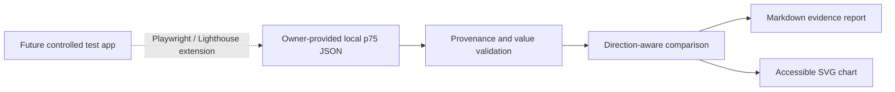

# Architecture

The fixture is the only evidence input. It records owner-provided local measurements and explicitly rejects production scope. The report generator calculates changes, classifies regressions and reports relevant lab thresholds without claiming real-user performance or causality.

## Evidence boundaries

- No request is made to AutismoConecta or any production site.
- No URL, header, cookie, user record or infrastructure identifier is stored.
- Generated Markdown and SVG are reproducible from the versioned fixture.
- A future Playwright or Lighthouse path must target a separately owned or explicitly authorized test application.
